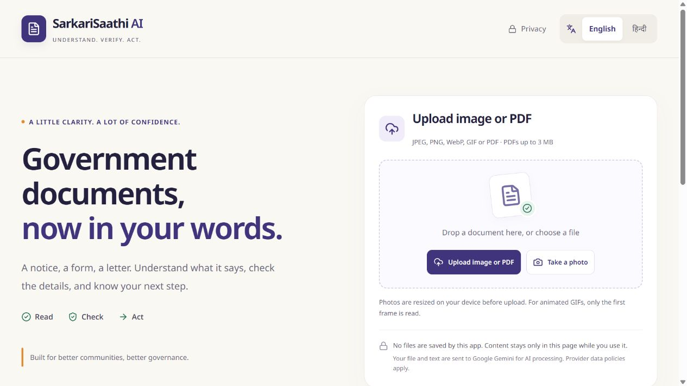
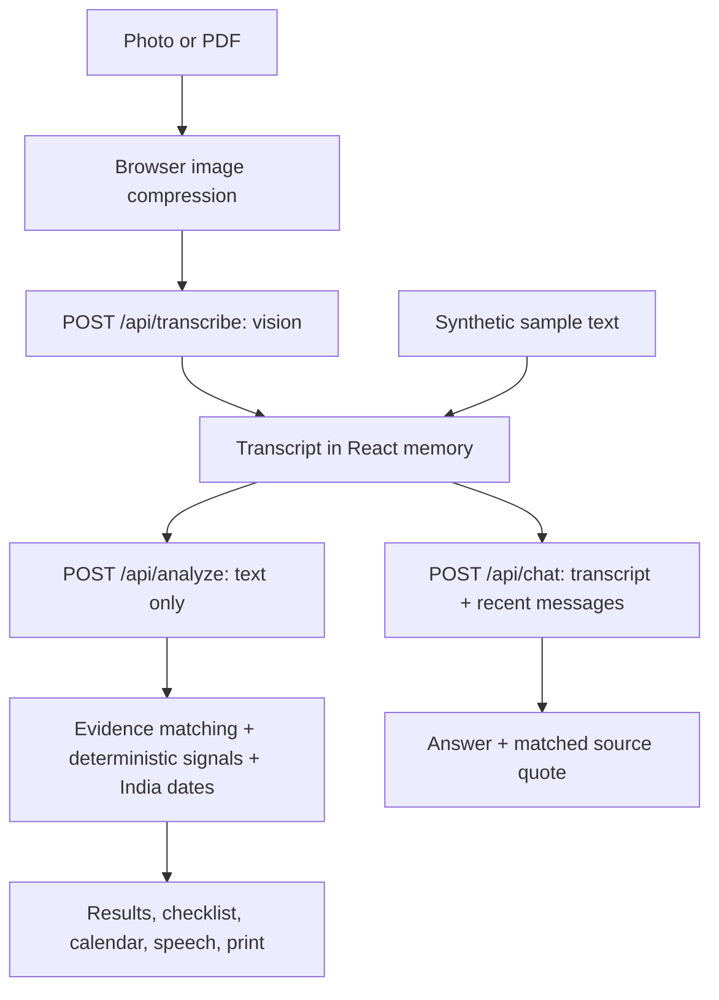

# SarkariSaathi AI

**Understand. Verify. Act.**

Live demo: _Add the Vercel URL after deployment._



## The problem

A family receives an unfamiliar electricity notice. The language is difficult, the deadline is unclear, and a payment link looks unusual. They need to understand the notice and decide what to check with the issuing office. SarkariSaathi explains the document, shows its evidence, and helps organise the next steps. It cannot establish authenticity.

## What it does

- Reads images and PDFs, then explains the extracted text in English or Hindi.
- Shows key fields, stated versus inferred steps, source quotes, missing information and confidence.
- Combines deterministic warning checks with AI findings into three carefully worded risk states.
- Computes deadlines in India time and offers calendar reminders, a checklist and browser speech.
- Answers follow-up questions using the transcript, with matched source quotes.
- Provides a privacy-filtered WhatsApp summary preview and a clean print layout.
- Includes three clearly labelled synthetic sample documents.

## Why this is not just a chatbot

EvidenceLink checks every quote against the transcript after Unicode and whitespace normalization. A quote match means the words occur in the transcript; it does **not** prove the original document or the model's interpretation is correct. Automated checks independently detect short links, unusual domains, UPI destinations, sensitive-data requests and pressure language. Code merges these signals with model findings, and computes dates instead of asking a model to do arithmetic. Stated and inferred instructions remain distinct. No result claims authenticity.

## Architecture



Next.js App Router, TypeScript, React, Tailwind CSS, Noto Sans and Noto Sans Devanagari, Zod, sharp, pdf-lib, Vitest. Node.js API routes have `maxDuration = 60`. All AI calls use the Google Gemini REST API. There is no database or persistent document session.

## Setup

Use Node.js 22 or newer. Preserve an existing `.env`; do not overwrite your credentials.

```powershell
npm install
Copy-Item .env.example .env.local
# Edit .env.local and set GEMINI_API_KEY
npm run dev
```

Open http://127.0.0.1:5173. Both the page and API now run on this single origin; the old Express server on port 5000 is no longer used. Stop any old Vite/Express terminals first. Restart after editing environment variables. `.env.local` takes precedence over `.env`.

On this Windows machine, npm is not on PATH. The supplied launcher uses the bundled pnpm:

```powershell

.\run.ps1 dev
.\run.ps1 test
.\run.ps1 lint
.\run.ps1 build
.\run.ps1 start
```

| Variable | Purpose |
| --- | --- |
| `GEMINI_API_KEY` | Server-side Google AI Studio API key |
| `GEMINI_MODEL` | Gemini model supporting image/PDF input and structured output; default in `.env.example` |

Never use a `NEXT_PUBLIC_` prefix for an API key. No key is sent to the browser. There is no silent provider fallback or fabricated demo response. `/api/health` reports configuration presence, not credential validity. A missing key produces an actionable error. If Google reports permission denied, resolve the account/project/API-key access in Google AI Studio; application code cannot grant those permissions. Check the API project's own quotas and billing separately from a consumer Gemini subscription.

## Validation

```powershell
npm test
npm run lint
npm run build
```

Tests cover signal detection, quote normalization, India dates, ICS formatting, risk precedence, sharing filters, localization completeness, file rejection, shared rate limits, stateless API requests and Gemini transport. Provider responses are mocked in automated tests; they do not establish live account access. Browser QA covers English/Hindi navigation and missing-configuration handling. Live analysis, chat and speech-device compatibility require the manual checks below.

1. Configure a valid API key and restart the server.
2. Try each sample in English and Hindi. Check quote toggles and warning origins. The pressure sample must be orange.
3. Upload a readable image and a PDF; confirm the transcript matches the document.
4. Ask a question absent from the document and confirm the answer acknowledges missing information.
5. Check the deadline, download its ICS, tick action steps, and test speech on a device with the selected language voice installed.
6. Inspect the WhatsApp preview before opening it; print the results and start over.

## Deploy to Vercel

1. Place this source in your own repository when ready. No repository push or deployment has been performed by this task.
2. Import it into Vercel. The Next.js preset uses the normal build; no separate backend or `vercel.json` is required.
3. Add `GEMINI_API_KEY` and `GEMINI_MODEL` in Vercel project environment variables. Never commit `.env` or `.env.local`.
4. Deploy, visit `/api/health`, and run the manual sample checks. Redeploy after environment changes.

The 3 MB PDF limit keeps base64 requests below Vercel's request-body ceiling. Images are resized to 1600 pixels at JPEG quality 0.8 before upload. API timeouts return a retryable error rather than a partial result.

## Privacy

The app has no login, database, saved history, localStorage, analytics or document-content logging. Browser state disappears on reload or Start over. Servers transiently handle the document/text for each request; provider processing and retention follow the selected provider's separate policies. This app cannot promise that a provider retains nothing. Keys remain server-side. Share summaries use an allowlist of generic document types, verified currency amounts, dates and generic next steps; full transcripts, names, IDs, addresses and payment destinations are excluded. Review the preview before sharing.

## Samples

`src/lib/samples.ts` contains electricity, urgent-payment and scholarship texts, all visibly synthetic. Dates are generated at runtime relative to today in Asia/Kolkata. Sample buttons skip vision and call the real analysis endpoint, so an API key is still required. Names and destinations are fictional: never visit, call or pay sample destinations. Samples appear as a readable paper card in results.

## Limitations and implementation decisions

- The new brief's English/Hindi scope replaces the earlier ten-language interface. Explanatory output follows the selected language; evidence remains in the document's original script.
- AI and transcription can make mistakes. A green result means no obvious warning signs were detected, not that a document is authentic. Verify independently through an official website or the number on a previous bill.
- Complete dates with a year and matched source evidence are required for reminders. Ambiguous or unmatched deadlines are omitted.
- The 20-requests/IP/hour limiter is best-effort in serverless memory, shared across API routes within a process. Vercel's trusted IP header is used on Vercel; outside a trusted deployment all clients conservatively share one bucket. A production multi-instance deployment should use Redis or another shared store and explicit trusted-proxy configuration.
- PDFs must be unencrypted, no larger than 3 MB and at most 25 pages. Transcript limit: 15,000 characters. Image uploads are at most 20 MB before compression and 3 MB at the API; decoded images are limited to 25 million pixels. Only the first GIF frame is read.
- Sharing uses generic next steps instead of unrestricted model prose to prevent personal details leaking into WhatsApp. It opens a preview/link; it does not send a message automatically.
- Browser voices depend on the device. Camera capture depends on browser/device support. No voice input or built-in PDF export is included.
- No live AI result is claimed until a valid provider key is configured and the end-to-end checks succeed. A key is now configured. Live checks on 28 October 2026 confirmed model access, but Gemini 3.8 Flash returned HTTP 503 high-demand errors; full live workflow verification remains incomplete.

## Roadmap

WhatsApp bot; on-device redaction; official verification APIs; more Indian languages; voice input; distributed rate limiting and abuse controls.

See `CLAUDE.md` for contributor principles. Screenshots are in `docs/screenshots/`.

## Provider timeouts

Requests use a 55-second deadline within the 60-second route limit. Gemini 3/4 requests use low thinking effort; Gemini 2.5 uses a bounded thinking budget. User cancellation, provider overload (503), and deadline expiry have separate messages. Retry reuses an already extracted transcript rather than uploading the document again. Model availability in the listing does not guarantee generation access. No automatic provider or model switching occurs.

Gemini-only update: the default model is `gemini-3.1-flash-lite`. Requests use JSON mode with the required schema in the system instruction, then strict server-side Zod validation. This avoids the structured-schema request rejection observed during live tests. Claude code, SDK, provider selection, and environment settings have been removed.
